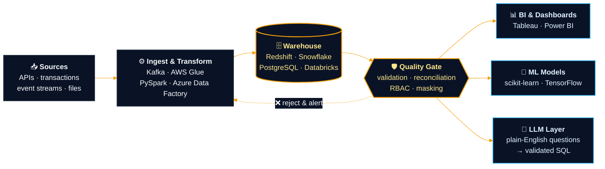

<!-- ════════════════════════════════════════════════════════════════
     KSN//OS — holographic profile interface
     Panels are generated by scripts/build_static.py (static) and
     scripts/constellation.py (daily, via GitHub Actions).
     ════════════════════════════════════════════════════════════════ -->

<p align="center">
  
</p>

<p align="center">
  <a href="#console"></a>
  <a href="#skills"></a>
  <a href="#trajectory"></a>
  <a href="#projects"></a>
  <a href="#uplink"></a>
</p>

<br/>


I am a **Forward Deployment AI Engineer and Enterprise Data Specialist** working across **Agentic AI**, **LLM Systems**, and **Scalable Cloud Data Architecture**. Currently at **Trida Labs**, I lead customer-facing engineering, deploying AI-powered analytics solutions into enterprise customer environments.

With a background delivering high-throughput data engineering and analytics in Fortune 500 environments (**Global Payments**, **Amazon**, **Vanguard**), I specialize in pairing LLMs with reliable, enterprise-grade data systems:

```diff
+ Agentic AI & LLM Systems   schema-aware prompts + guardrails, grounded in real data
+ Cloud Data Integration     secure, low-latency access to PostgreSQL · Snowflake · Databricks · Redshift
+ Enterprise Reliability     +30% pipeline scalability · −15% fraud false positives · −40–50% data anomalies
+ Security & Governance      RBAC · data masking · PCI-DSS across multi-tenant cloud and on-prem deployments
```

<br/>

<a id="console"></a>


<p align="center">
  
</p>

<br/>

<a id="skills"></a>


<p align="center">
  
</p>

<details>
<summary><b>▸ Expand full skills matrix</b></summary>
<br/>

| Domain | Technologies &amp; Platforms |
| :--- | :--- |
| **Agentic AI &amp; LLM Systems** | `Text-to-SQL` `LLM Orchestration` `SQL Validation Guardrails` `Context Caching` `LangChain` `Hugging Face` `Generative AI` |
| **Enterprise Cloud &amp; Warehousing** | `Snowflake` `Databricks` `AWS Redshift` `AWS Glue` `AWS Lambda` `AWS Athena` `AWS Data Pipeline` `Azure Data Factory` `Microsoft Fabric` `Informatica` |
| **Core Languages &amp; Querying** | `Python` `Advanced SQL (PostgreSQL, Redshift, Snowflake, T-SQL)` `PySpark` `Bash` |
| **Big Data, Streaming &amp; ETL** | `Apache Spark` `Apache Kafka` `Distributed ETL` `Data Modeling` `Data Quality Validation Frameworks` `Schema Drift Auditing` |
| **Security, RBAC &amp; Compliance** | `Enterprise RBAC` `Data Governance` `Data Masking` `Multi-Tenant Deployments` `PCI-DSS Compliance` |
| **BI &amp; Decision Intelligence** | `Tableau` `Power BI` `Power Apps` `Power Automate` `Pandas` `NumPy` `Matplotlib` `Seaborn` |
| **Databases &amp; Dev Ecosystem** | `PostgreSQL` `Redshift` `Snowflake` `Databricks` `SQL Server` `MongoDB` `REST APIs` `Git / GitHub` `Docker` `VS Code` |

</details>

<br/>

<a id="trajectory"></a>


<p align="center">
  
</p>

<br/>


<details open>
<summary><b>◉ LOG 05 — Trida Labs</b> · Forward Deployment AI Engineer · <i>May 2025 – Present</i> · Hyderabad, India · Full-time</summary>
<br/>

- **Enterprise Deployment:** Leading customer-facing engineering and enterprise deployment of AI-powered analytics solutions across customer environments.
- **Natural-Language Analytics:** Enabling non-technical stakeholders to explore data and build dashboards from plain-English questions, backed by production-grade SQL.
- **LLM & Data Integration:** Connecting LLMs and agentic AI workflows to clients' distributed databases (**PostgreSQL, Snowflake, Databricks, Redshift**).
- **Guardrails & Accuracy:** Design schema-aware prompt pipelines and SQL validation guardrails that reduce LLM hallucinations on complex multi-table queries.
- **Product-Engineering Bridge:** Translate enterprise client requirements into product engineering priorities, identifying edge-case query patterns and optimizing execution latency.
- **Security & RBAC:** Configure enterprise role-based access controls (**RBAC**) and data governance policies to guarantee compliance and security across multi-tenant cloud and on-prem deployments.

<sub><b>Skills:</b> Agentic AI · Text-to-SQL · LLM Orchestration · Python · SQL · Enterprise Data Integration · RBAC</sub>
</details>

<details>
<summary><b>◉ LOG 04 — Global Payments Inc.</b> · Data Analytics Engineer · <i>Mar 2024 – Jan 2025 (11 mos)</i> · Atlanta, GA · Contract</summary>
<br/>

- **Transaction Stream Analytics:** Analyzed high-throughput multi-channel transaction datasets using **Python** and advanced **SQL**, identifying bottleneck patterns and optimizing payment processing workflows across distributed gateways.
- **Operational BI Dashboards:** Developed and maintained operational **Tableau** dashboards integrated with live payment streams, providing real-time visibility into settlement KPIs, transaction failure rates, and interchange metrics for executive and risk teams.
- **Fraud Detection Optimization:** Collaborated with fraud analytics teams to analyze historical transaction anomalies, refining fraud detection feature inputs to improve predictive model precision and decrease false positives by **15%**.
- **Resilient ETL Pipelines:** Refined core ETL workflows in tandem with Data Engineering using **AWS Redshift** and **Informatica**, ensuring data pipeline resiliency, consistent data staging, and minimal downstream reporting latency.
- **Data Quality & Compliance:** Established automated data quality and validation frameworks across transactional tables, reducing data anomalies by **40%** and ensuring adherence to **PCI-DSS** regulatory reporting standards.

<sub><b>Skills:</b> Amazon Redshift · Python · SQL · Tableau · Informatica · Fraud Detection Analytics · Data Quality Frameworks · ETL</sub>
</details>

<details>
<summary><b>◉ LOG 03 — Amazon</b> · Data Engineer · <i>Sep 2023 – Jan 2024 (5 mos)</i> · Seattle, WA · Contract</summary>
<br/>

- **Scalable Cloud ETL:** Engineered pipeline enhancements across **AWS Glue** and **Informatica**, realizing a **30% improvement** in scalability, throughput, and ingestion uptime.
- **Workflow Automation:** Automated ingestion and transformation workflows with **AWS Data Pipeline**, reducing manual operational intervention by **25%**.
- **Data Quality Auditing:** Deployed automated data quality audits and reconciliation in **AWS Redshift & Athena**, cutting dataset discrepancies by **50%**.

<sub><b>Skills:</b> AWS Glue · AWS Redshift · AWS Athena · AWS Data Pipeline · Informatica · PySpark · SQL</sub>
</details>

<details>
<summary><b>◉ LOG 02 — Vanguard</b> · Data Analyst · <i>Jul 2022 – Dec 2022 (6 mos)</i> · Malvern, PA · Contract</summary>
<br/>

- **Executive BI Suites:** Optimized enterprise **Tableau** and **Power BI** suites linked to PostgreSQL and SQL Server, driving a **15% gain** in operational turnaround for financial performance reporting.
- **Cloud Orchestration:** Orchestrated **Azure Data Factory** and **Microsoft Fabric** pipelines with REST APIs for continuous analytical feeds and automated data refreshes.

<sub><b>Skills:</b> Power BI · Tableau · Azure Data Factory · Microsoft Fabric · PostgreSQL · SQL Server · REST APIs</sub>
</details>

<br/>




<br/>

<a id="projects"></a>


<table>
  <tr>
    <td width="50%" valign="top">
      <h4>💳 Real-Time Payment Streaming &amp; Fraud Detection</h4>
      <p><i>Event-driven fintech analytics pipeline monitoring high-volume transaction streams in real time with sub-second alert latency.</i></p>
      <ul>
        <li>Implemented high-throughput streaming ingestion with <b>Apache Kafka</b> and event-driven serverless processing via <b>AWS Lambda</b>.</li>
        <li>Refined anomaly feature inputs and detection heuristics, cutting false-positive fraud flags by <b>15% to 25%</b> across distributed payment gateways.</li>
        <li>Aggregated telemetry into <b>AWS Redshift</b> and <b>MongoDB</b> with live <b>Tableau</b> executive risk cockpits adhering to <b>PCI-DSS</b> standards.</li>
      </ul>
      <p>
        <code>Python</code> • <code>Apache Kafka</code> • <code>AWS Lambda</code> • <code>AWS Redshift</code> • <code>MongoDB</code> • <code>Tableau</code> • <code>PCI-DSS</code>
      </p>
    </td>
    <td width="50%" valign="top">
      <h4>📊 Chicago Urban Crime Analytics &amp; Predictive Dispatch</h4>
      <p><i>Spatial-temporal machine learning platform modeling municipal incident densities to optimize tactical law enforcement resource allocation.</i></p>
      <ul>
        <li>Conducted large-scale spatial-temporal preprocessing and feature engineering on urban datasets using <b>Pandas</b> and <b>NumPy</b>.</li>
        <li>Trained supervised classification and regression ensembles in <b>Scikit-Learn</b>, providing risk hotspot mapping that contributed to a <b>12% crime reduction</b> in target zones.</li>
        <li>Delivered an interactive, self-updating <b>Tableau</b> geospatial decision-support cockpit for command center operations.</li>
      </ul>
      <p>
        <code>Python</code> • <code>Scikit-Learn</code> • <code>Pandas</code> • <code>NumPy</code> • <code>Tableau</code> • <code>Geospatial AI</code>
      </p>
    </td>
  </tr>
  <tr>
    <td colspan="2" valign="top">
      <h4>🚗 Edge Computer Vision &amp; Vehicle Plate Governance</h4>
      <p><i>Deep Learning computer vision edge pipeline for low-latency vehicle identification and automated traffic flow governance.</i></p>
      <ul>
        <li>Trained and fine-tuned a custom <b>YOLO-based CNN</b> architecture to extract vehicle registration plates with <b>95% recognition accuracy</b>.</li>
        <li>Engineered low-latency image preprocessing and frame filtering pipelines utilizing <b>OpenCV</b> and <b>TensorFlow</b> on edge devices.</li>
        <li>Streamlined automated vehicle governance workflows, replacing manual monitoring bottlenecks with instant event triggers.</li>
      </ul>
      <p>
        <code>Python</code> • <code>YOLO CNN</code> • <code>TensorFlow</code> • <code>OpenCV</code> • <code>NumPy</code> • <code>Edge AI</code>
      </p>
    </td>
  </tr>
</table>

<br/>


<p align="center">
  
</p>

<br/>


```yaml
Education:
  - Degree: "Master of Professional Studies in Data Science"
    Institution: "University of Maryland Baltimore County (UMBC) — Baltimore, MD"
    Graduated: "May 2023"
  - Degree: "Bachelor of Science in Technology (Minors: Business Management & German)"
    Institution: "Amity University of Rajasthan — Jaipur, India"
    Graduated: "May 2021"

Certifications:
  - "Associate Data Engineer" — Amazon Web Services (AWS)
  - "Academy Accreditation: Generative AI Fundamentals" — Databricks
  - "Build LLM Evaluation Applications with LangChain" — LinkedIn
  - "Execute and Evaluate Hugging Face AI Models" — LinkedIn
  - "Career Skills in Data Analytics" — LinkedIn
```

<br/>

<a id="uplink"></a>


<p align="center">
  <i>Channel open for conversations on Agentic AI, LLM systems, natural-language analytics, and distributed data architectures.</i>
</p>

<p align="center">
  <a href="https://www.linkedin.com/in/krishna-sidhvi-nekkanti/"></a>
  <a href="mailto:krishnanekkanti04@gmail.com"></a>
  <a href="https://github.com/krishnasidhvi"></a>
  <a href="https://wa.me/REDACTED?text=Hi%20Krishna,%20I%20reviewed%20your%20profile%20and%20would%20like%20to%20connect%20regarding%20an%20opportunity."></a>
</p>

<br/>

<p align="center">
  
</p>
