<p align="center">
  
</p>

<p align="center">
  <a href="https://www.linkedin.com/in/krishna-sidhvi-nekkanti/"></a>
  <a href="mailto:krishnanekkanti04@gmail.com"></a>
  <a href="https://github.com/krishnasidhvi"></a>
  <a href="#portfolio"></a>
  <a href="https://wa.me/918341145666?text=Hi%20Krishna,%20I%20reviewed%20your%20profile%20and%20would%20like%20to%20connect%20regarding%20an%20opportunity."></a>
</p>

---

### ✦ Executive Overview

I am a **Forward Deployment AI Engineer and Enterprise Data Specialist** operating at the bleeding edge of **Agentic AI**, **Autonomous Text-to-SQL**, **Model Context Protocol (MCP)**, and **Scalable Cloud Data Architecture**. Currently at **Trida Labs**, I lead customer-facing engineering and enterprise deployment for the AI-native analytics ecosystem, operationalizing **AgentSQL** (agentic Text-to-SQL & dynamic dashboard engine) and **TridaPad** (collaborative data workspace) across mission-critical customer infrastructures.

With a rich pedigree delivering high-throughput data engineering and analytics across Fortune 500 environments (**Global Payments**, **Amazon**, **Vanguard**), I specialize in synthesizing frontier LLMs with deterministic, enterprise-grade database systems:

* **Autonomous Text-to-SQL & Agentic AI:** Operationalize AgentSQL with schema-aware contextual prompt pipelines and deterministic SQL guardrails, achieving **99%+ syntactic and relational accuracy** on complex multi-table joins while completely eliminating LLM hallucinations.
* **Model Context Protocol (MCP) Integrations:** Implement and optimize production MCP server integrations that securely bridge frontier LLMs and agentic tools directly to clients' distributed data lakes and warehouses (**PostgreSQL, Snowflake, Databricks, Redshift**).
* **Enterprise Reliability & Performance:** Proven track record of improving pipeline uptime and scalability by **+30%**, reducing fraud model false positives by **-15%**, and eliminating transactional data anomalies by **-40% to -50%**.
* **Security & Multi-Tenant Governance:** Deep expertise configuring enterprise role-based access control (**RBAC**), data masking, and **PCI-DSS** compliance across multi-tenant cloud and on-premise customer deployments.

---

### ✦ Enterprise Experience & Milestones

<table>
  <thead>
    <tr style="border-bottom: 2px solid #F59E0B;">
      <th align="left">Organization &amp; Tenure</th>
      <th align="left">Role</th>
      <th align="left">Key Impact &amp; Technologies</th>
    </tr>
  </thead>
  <tbody>
    <tr>
      <td width="24%">
        <b>Trida Labs</b><br/>
        <sub>Hyderabad, Telangana, India<br/>Full-time<br/><b>May 2025 – Present</b></sub>
      </td>
      <td width="23%">
        <b>Forward Deployment AI Engineer</b>
      </td>
      <td>
        • <b>Enterprise Deployment:</b> Spearheading customer-facing engineering and enterprise deployment for Trida Labs’ AI-native analytics ecosystem, including <b>TridaPad</b> (collaborative data workspace) and <b>AgentSQL</b> (autonomous Text-to-SQL &amp; dashboard engine).<br/>
        • <b>Autonomous Text-to-SQL:</b> Deploy and operationalize <b>AgentSQL</b> across enterprise customer architectures, enabling non-technical stakeholders to autonomously generate production-grade SQL and dynamic dashboards from natural language queries.<br/>
        • <b>Model Context Protocol (MCP):</b> Implement and optimize <b>MCP server integrations</b>, seamlessly connecting external LLMs and agentic AI tools directly to clients' distributed databases (<b>PostgreSQL, Snowflake, Databricks, Redshift</b>).<br/>
        • <b>Deterministic Guardrails:</b> Design schema-aware contextual prompt pipelines and deterministic SQL guardrails, minimizing LLM hallucinations and ensuring <b>99%+ syntactic and relational accuracy</b> on complex multi-table joins.<br/>
        • <b>Product-Engineering Bridge:</b> Bridge enterprise client requirements with core product engineering, identifying edge-case query patterns, optimizing execution latency, and tailoring real-time analytics collaboration workflows within <b>TridaPad</b>.<br/>
        • <b>Security &amp; RBAC:</b> Configure enterprise role-based access controls (<b>RBAC</b>) and data governance policies to guarantee compliance and security across multi-tenant cloud and on-prem deployments.<br/>
        <sub><b>Skills:</b> Agentic AI · Text-to-SQL · Model Context Protocol (MCP) · LLM Orchestration · Python · SQL · Enterprise Data Integration · TridaPad · AgentSQL</sub>
      </td>
    </tr>
    <tr>
      <td width="24%">
        <b>Global Payments Inc.</b><br/>
        <sub>Atlanta, GA, United States<br/>Contract (Hybrid/Remote)<br/><b>Mar 2024 – Jan 2025 (11 mos)</b></sub>
      </td>
      <td width="23%">
        <b>Data Analytics Engineer</b>
      </td>
      <td>
        • <b>Transaction Stream Analytics:</b> Analyzed high-throughput multi-channel transaction datasets using <b>Python</b> and advanced <b>SQL</b>, identifying bottleneck patterns and optimizing payment processing workflows across distributed gateways.<br/>
        • <b>Operational BI Dashboards:</b> Developed and maintained operational <b>Tableau</b> dashboards integrated with live payment streams, providing real-time visibility into settlement KPIs, transaction failure rates, and interchange metrics for executive and risk teams.<br/>
        • <b>Fraud Detection Optimization:</b> Collaborated with fraud analytics teams to analyze historical transaction anomalies, refining fraud detection feature inputs to improve predictive model precision and decrease false positives by <b>15%</b>.<br/>
        • <b>Resilient ETL Pipelines:</b> Refined core ETL workflows in tandem with Data Engineering using <b>AWS Redshift</b> and <b>Informatica</b>, ensuring data pipeline resiliency, consistent data staging, and minimal downstream reporting latency.<br/>
        • <b>Data Quality &amp; Compliance:</b> Established automated data quality and validation frameworks across transactional tables, reducing data anomalies by <b>40%</b> and ensuring adherence to <b>PCI-DSS</b> regulatory reporting standards.<br/>
        <sub><b>Skills:</b> Amazon Redshift · Python · SQL · Tableau · Informatica · Fraud Detection Analytics · Data Quality Frameworks · ETL</sub>
      </td>
    </tr>
    <tr>
      <td width="24%">
        <b>Amazon</b><br/>
        <sub>Seattle, WA, United States<br/>Contract<br/><b>Sep 2023 – Jan 2024 (5 mos)</b></sub>
      </td>
      <td width="23%">
        <b>Data Engineer</b>
      </td>
      <td>
        • <b>Scalable Cloud ETL:</b> Engineered pipeline enhancements across <b>AWS Glue</b> and <b>Informatica</b>, realizing a <b>30% improvement</b> in scalability, throughput, and ingestion uptime.<br/>
        • <b>Workflow Automation:</b> Automated ingestion and transformation workflows with <b>AWS Data Pipeline</b>, reducing manual operational intervention by <b>25%</b>.<br/>
        • <b>Data Quality Auditing:</b> Deployed automated data quality audits and reconciliation in <b>AWS Redshift &amp; Athena</b>, cutting dataset discrepancies by <b>50%</b>.<br/>
        <sub><b>Skills:</b> AWS Glue · AWS Redshift · AWS Athena · AWS Data Pipeline · Informatica · PySpark · SQL</sub>
      </td>
    </tr>
    <tr>
      <td width="24%">
        <b>Vanguard</b><br/>
        <sub>Malvern, PA, United States<br/>Contract<br/><b>Jul 2022 – Dec 2022 (6 mos)</b></sub>
      </td>
      <td width="23%">
        <b>Data Analyst</b>
      </td>
      <td>
        • <b>Executive BI Suites:</b> Optimized enterprise <b>Tableau</b> and <b>Power BI</b> suites linked to PostgreSQL and SQL Server, driving a <b>15% gain</b> in operational turnaround for financial performance reporting.<br/>
        • <b>Cloud Orchestration:</b> Orchestrated <b>Azure Data Factory</b> and <b>Microsoft Fabric</b> pipelines with REST APIs for continuous analytical feeds and automated data refreshes.<br/>
        <sub><b>Skills:</b> Power BI · Tableau · Azure Data Factory · Microsoft Fabric · PostgreSQL · SQL Server · REST APIs</sub>
      </td>
    </tr>
  </tbody>
</table>

---

<a id="portfolio"></a>
### ✦ Flagship Projects &amp; Research Portfolio

<table>
  <tr>
    <td width="50%" valign="top">
      <h4>🤖 AgentSQL &amp; MCP Autonomous Enterprise Data Engine</h4>
      <p><i>Agentic Text-to-SQL orchestration engine connecting frontier LLMs via Model Context Protocol (MCP) to distributed customer data warehouses.</i></p>
      <ul>
        <li>Implemented low-latency <b>Model Context Protocol (MCP)</b> server integrations bridging agentic tools directly to <b>PostgreSQL, Snowflake, Databricks, and Redshift</b>.</li>
        <li>Engineered schema-aware prompt pipelines and deterministic SQL AST validation guardrails, achieving <b>99%+ syntactic and relational join precision</b>.</li>
        <li>Enabled autonomous natural language generation of production-ready SQL queries and dynamic dashboard visualizations inside <b>TridaPad</b>.</li>
      </ul>
      <p>
        <code>Agentic AI</code> • <code>MCP</code> • <code>Text-to-SQL</code> • <code>Python</code> • <code>PostgreSQL</code> • <code>Snowflake</code> • <code>Deterministic Guardrails</code>
      </p>
    </td>
    <td width="50%" valign="top">
      <h4>💳 Real-Time Payment Streaming &amp; Fraud Detection</h4>
      <p><i>Event-driven fintech analytics pipeline monitoring high-volume transaction streams in real time with sub-second alert latency.</i></p>
      <ul>
        <li>Implemented high-throughput streaming ingestion with <b>Apache Kafka</b> and event-driven serverless processing via <b>AWS Lambda</b>.</li>
        <li>Refined anomaly feature inputs and detection heuristics, cutting false-positive fraud flags by <b>15% to 25%</b> across distributed payment gateways.</li>
        <li>Aggregated telemetry into <b>AWS Redshift</b> and <b>MongoDB</b> with live <b>Tableau</b> executive risk cockpits adhering to <b>PCI-DSS</b> standards.</li>
      </ul>
      <p>
        <code>Python</code> • <code>Apache Kafka</code> • <code>AWS Lambda</code> • <code>AWS Redshift</code> • <code>MongoDB</code> • <code>Tableau</code> • <code>PCI-DSS</code>
      </p>
    </td>
  </tr>
  <tr>
    <td width="50%" valign="top">
      <h4>📊 Chicago Urban Crime Analytics &amp; Predictive Dispatch</h4>
      <p><i>Spatial-temporal machine learning platform modeling municipal incident densities to optimize tactical law enforcement resource allocation.</i></p>
      <ul>
        <li>Conducted large-scale spatial-temporal preprocessing and feature engineering on urban datasets using <b>Pandas</b> and <b>NumPy</b>.</li>
        <li>Trained supervised classification and regression ensembles in <b>Scikit-Learn</b>, providing risk hotspot mapping that contributed to a <b>12% crime reduction</b> in target zones.</li>
        <li>Delivered an interactive, self-updating <b>Tableau</b> geospatial decision-support cockpit for command center operations.</li>
      </ul>
      <p>
        <code>Python</code> • <code>Scikit-Learn</code> • <code>Pandas</code> • <code>NumPy</code> • <code>Tableau</code> • <code>Geospatial AI</code>
      </p>
    </td>
    <td width="50%" valign="top">
      <h4>🚗 Edge Computer Vision &amp; Vehicle Plate Governance</h4>
      <p><i>Deep Learning computer vision edge pipeline for low-latency vehicle identification and automated traffic flow governance.</i></p>
      <ul>
        <li>Trained and fine-tuned a custom <b>YOLO-based CNN</b> architecture to extract vehicle registration plates with <b>95% recognition accuracy</b>.</li>
        <li>Engineered low-latency image preprocessing and frame filtering pipelines utilizing <b>OpenCV</b> and <b>TensorFlow</b> on edge devices.</li>
        <li>Streamlined automated vehicle governance workflows, replacing manual monitoring bottlenecks with instant event triggers.</li>
      </ul>
      <p>
        <code>Python</code> • <code>YOLO CNN</code> • <code>TensorFlow</code> • <code>OpenCV</code> • <code>NumPy</code> • <code>Edge AI</code>
      </p>
    </td>
  </tr>
</table>

---

### ✦ Technical Skills Matrix

<div align="center">

| Domain | Technologies &amp; Platforms |
| :--- | :--- |
| **Agentic AI &amp; LLM Systems** | `AgentSQL` `Model Context Protocol (MCP)` `Text-to-SQL` `LLM Orchestration` `Deterministic SQL Guardrails` `Context Caching` `LangChain` `Hugging Face` `Generative AI` |
| **Enterprise Cloud &amp; Warehousing** | `TridaPad` `Snowflake` `Databricks` `AWS Redshift` `AWS Glue` `AWS Lambda` `AWS Athena` `AWS Data Pipeline` `Azure Data Factory` `Microsoft Fabric` `Informatica` |
| **Core Languages &amp; Querying** | `Python` `Advanced SQL (PostgreSQL, Redshift, Snowflake, T-SQL)` `PySpark` `Bash` |
| **Big Data, Streaming &amp; ETL** | `Apache Spark` `Apache Kafka` `Distributed ETL` `Data Modeling` `Data Quality Validation Frameworks` `Schema Drift Auditing` |
| **Security, RBAC &amp; Compliance** | `Enterprise RBAC` `Data Governance` `Data Masking` `Multi-Tenant Deployments` `PCI-DSS Compliance` |
| **BI &amp; Decision Intelligence** | `Tableau` `Power BI` `Power Apps` `Power Automate` `Pandas` `NumPy` `Matplotlib` `Seaborn` |
| **Databases &amp; Dev Ecosystem** | `PostgreSQL` `Redshift` `Snowflake` `Databricks` `SQL Server` `MongoDB` `REST APIs` `Git / GitHub` `Docker` `VS Code` |

</div>

---

### ✦ Education &amp; Verified Certifications

```yaml
Education:
  - Degree: "Master of Professional Studies in Data Science"
    Institution: "University of Maryland Baltimore County (UMBC) — Baltimore, MD"
    Graduated: "May 2023"
  - Degree: "Bachelor of Science in Technology (Minors: Business Management & German)"
    Institution: "Amity University of Rajasthan — Jaipur, India"
    Graduated: "May 2021"

Certifications:
  - "Associate Data Engineer" — Amazon Web Services (AWS)
  - "Academy Accreditation: Generative AI Fundamentals" — Databricks
  - "Build LLM Evaluation Applications with LangChain" — LinkedIn
  - "Execute and Evaluate Hugging Face AI Models" — LinkedIn
  - "Career Skills in Data Analytics" — LinkedIn
```

---

### ✦ GitHub Activity &amp; Analytics

<p align="center">
  
  
</p>

<p align="center">
  
</p>

---

### ✦ Connect &amp; Collaborate

<p align="center">
  Interested in discussing Agentic AI deployment, Model Context Protocol (MCP) integrations, autonomous Text-to-SQL, or distributed data architectures?
  <br/><br/>
  <a href="https://www.linkedin.com/in/krishna-sidhvi-nekkanti/">
    
  </a>
  &nbsp;&nbsp;
  <a href="mailto:krishnanekkanti04@gmail.com">
    
  </a>
  &nbsp;&nbsp;
  <a href="https://github.com/krishnasidhvi">
    
  </a>
  &nbsp;&nbsp;
  <a href="https://wa.me/918341145666?text=Hi%20Krishna,%20I%20reviewed%20your%20profile%20and%20would%20like%20to%20connect%20regarding%20an%20opportunity.">
    
  </a>
</p>

<br/>

<p align="center">
  
</p>
